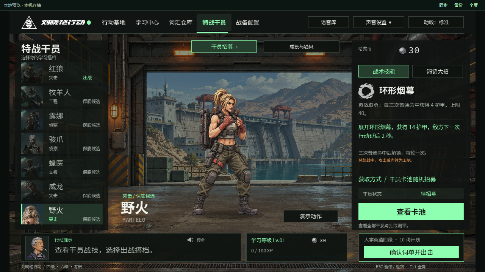
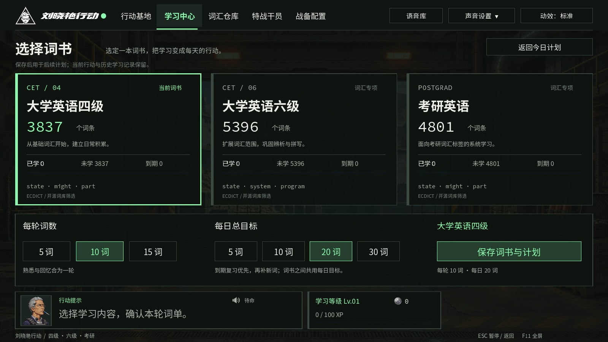
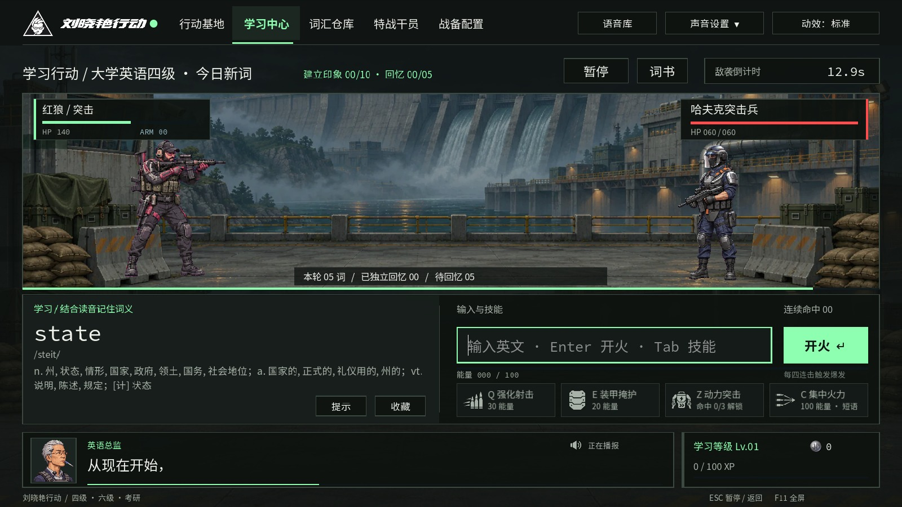
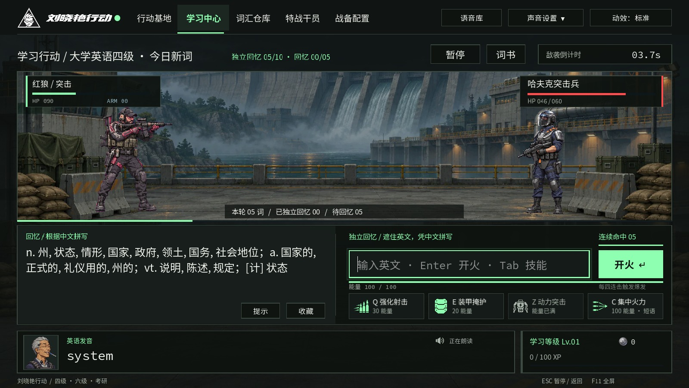
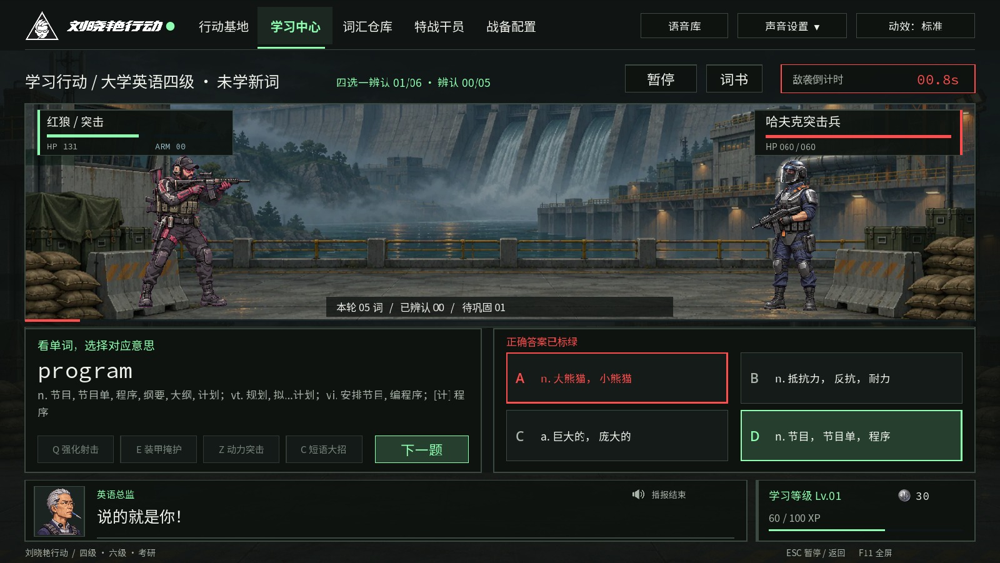
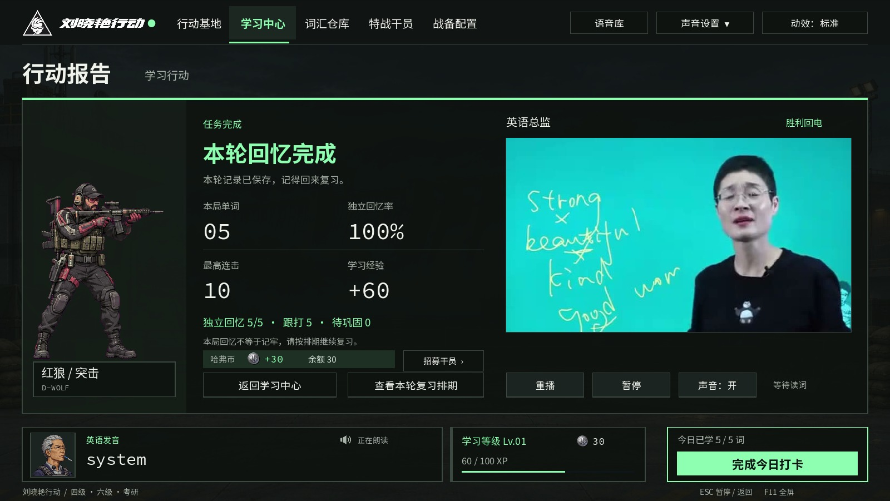
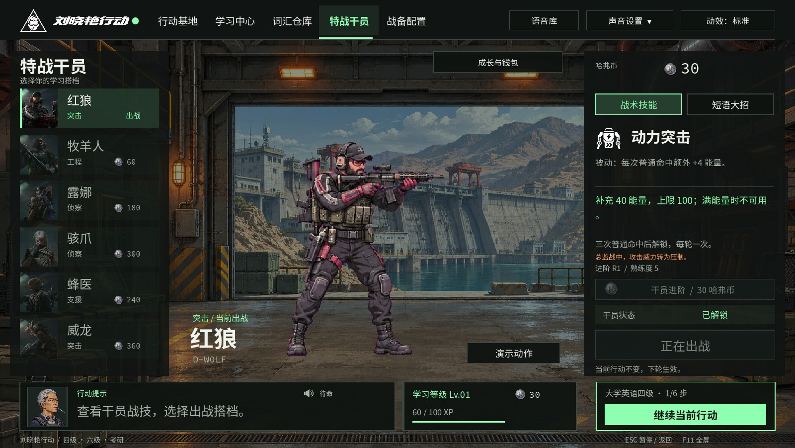

# 刘晓艳行动

**把背单词变成一场行动。**

刘晓艳行动是一款把英语单词学习融入闯关战斗的游戏，由 Git源宝团队制作。选择中考、高考、四级、六级或考研词书，通过拼写和四选一练习完成训练，在战斗中积累经验、获得哈弗币，并按学习计划持续复习。

这个公开仓库用于分享游戏项目、提供版本下载、记录后续更新，也欢迎大家反馈体验和问题。

**[在线试玩](https://gityuanbao.github.io/liuxiaoyan-action/)** · **[视频教程](https://www.bilibili.com/video/BV1bNsb6fENp/)** · **[下载 v51 完整项目包](https://github.com/gityuanbao/liuxiaoyan-action/releases/download/v51/liuxiaoyan-action-v51-godot-github.zip)** · **[查看所有版本](https://github.com/gityuanbao/liuxiaoyan-action/releases)** · **[反馈问题](https://github.com/gityuanbao/liuxiaoyan-action/issues)**

> 当前版本为 **v56（Godot）**。在线试玩与 `main` 源码同步更新，网页版沿用当前浏览器的学习存档。历史发布包可在 Releases 查看。

## v56 更新

- 特战干员页在机库内展示全身 2D 角色。选中野火会自动播放入场动作，休息时循环待机，可单独演示两个技能。
- 招募每次消耗 30 哈弗币，每抽返还 3、6 或 9 币，另有 5% 概率返还 300 币。每满 40 抽，从尚未获得的干员中随机解锁一名。
- 答题时可以收藏单词，在「收藏单词」里跨词书单独复习。选择题在反馈后自动切换，手机横屏提供两种四选一模式，电脑也支持拼写。



[查看手机横屏展示](docs/screenshots/v56-mobile-wildfire.png)

## 视频教程

第一次体验，可以先观看 **[刘晓艳行动视频教程（B 站）](https://www.bilibili.com/video/BV1bNsb6fENp/)**，再在线试玩或按下方说明下载运行。

## 游戏实机截图

下面保留 **v51 桌面网页版的流程截图**，涵盖选词书、答题和结算。

### 选择今天的行动

从首页进入词汇行动、远征战场、英语总监挑战或记忆训练，也可以先到行动基地整备干员。


### 选词书，安排每轮词数和每日目标

四级、六级、考研三本词书可选。设置每轮练习量与每日目标后，学习中心会列出本轮单词和今天的完成进度。



<details>
<summary>展开查看学习中心：词单预览、答题模式和每日进度</summary>


</details>

### 拼写出招，再遮住英文独立回忆

先结合单词、音标和中文释义建立印象，在输入框拼出单词，按 **Enter** 开火。熟悉这一组后，会进入根据中文提示独立拼写的回忆阶段。



<details>
<summary>展开查看独立回忆阶段：遮住英文，根据中文拼写</summary>



</details>

### 四选一辨认词义，答错后看解析

也可以切换为选择题训练。图中实际答错了一题：错误选项标红、正确答案标绿，左侧补充完整释义，并把这道题加入后续巩固。



### 完成一轮训练，查看行动报告

这次实机演示完成了 **5 个单词的学习和独立回忆**。结算页展示本局词数、回忆率、连击、学习经验和哈弗币，也能继续查看复习排期、完成每日打卡。



### 按路线推进远征关卡

远征模式包含四个区域、十二关行动。选择关卡后，可以查看遭遇场景、目标生命和首通奖励，再开始这一段行动。


### 挑战英语总监

百词挑战把训练带进首领战：面对 **100 词、5,000 血量**的英语总监，画面会显示挑战进度、当前阶段、词汇护甲和攻击倒计时。


### 选择干员，了解战术技能

在干员界面查看角色、解锁条件、战术技能和短语大招，再选择自己的学习搭档。图中展示的是红狼与“动力突击”技能。



## 可以怎么玩

- **按考试选词书**：中考、高考、大学英语四级、大学英语六级和考研英语。
- **拼写与四选一训练**：拼写练习用于主动回忆；选择题帮助辨认词义，答题后有反馈，错题会穿插重练。
- **制定学习计划**：每轮可选 5 / 10 / 15 个词，每日目标可选 5 / 10 / 20 / 30 个词。
- **战斗与成长**：把单词输入融入战斗，获得经验和哈弗币，体验远征关卡、职业技能和成长系统。
- **百词挑战**：挑战“英语总监”，完成 100 词训练。
- **间隔复习与打卡**：使用 FSRS 安排复习，记录每日目标与学习进度；同一单词在同一天只计一次。
- **单词读音**：网页版已随包提供单词语音资源。

| 词书 | 当前词条数 |
| --- | ---: |
| 中考英语 | 1,597 |
| 高考英语 | 3,674 |
| 大学英语四级 | 3,836 |
| 大学英语六级 | 5,390 |
| 考研英语 | 4,793 |

以上为各词书的词条数，不同词书之间可能包含相同单词。

## 下载与运行

### 方式一：直接在线试玩（推荐）

打开 **[刘晓艳行动网页版](https://gityuanbao.github.io/liuxiaoyan-action/)**，等待页面显示“整备完成”，再点击“开始行动”。首次打开需要加载游戏资源。手机游玩时请横屏使用。

在线试玩无需安装 Python、Godot 或 Node.js，也不用在电脑上启动服务。分享给朋友时，直接发送这个在线试玩链接即可。

### 方式二：下载后在本机运行

适合希望保留一份完整项目、从本机运行网页版的玩家。**本机地址只有在下面的服务启动后才能打开。**

1. 下载并解压 [当前 main 源码 ZIP](https://github.com/gityuanbao/liuxiaoyan-action/archive/refs/heads/main.zip)。v51 的完整归档可在 [Releases](https://github.com/gityuanbao/liuxiaoyan-action/releases) 下载。
2. 完整解压压缩包，打开能同时看到 `README.md` 和 `docs` 文件夹的项目根目录。
3. 安装 Python 3，在这个文件夹中打开终端。Windows 可以在文件资源管理器的地址栏输入 `powershell` 并回车，然后运行：

   ```bash
   python -m http.server 8000 --bind 127.0.0.1 --directory docs
   ```

   Windows 如果提示找不到 `python`，可尝试将命令开头改为 `py`。

4. 等终端出现 `Serving HTTP on 127.0.0.1 port 8000` 后，再点击 **[打开本机游戏](http://127.0.0.1:8000/)**。也可以只复制 `http://127.0.0.1:8000/` 到浏览器地址栏，不要带星号或后面的说明文字。
5. 等待资源加载完成，点击“开始行动”。

运行时请保持终端窗口开启；结束后按 `Ctrl+C` 停止本地服务。请通过上面的本机地址打开游戏，不要直接双击 `docs/index.html`。`127.0.0.1` 和 `localhost` 都指向当前这台电脑，不能作为试玩地址发给其他人；对外分享请使用上方的在线试玩链接。

### 方式三：在 Godot 编辑器中运行

适合希望查看项目、调整玩法或继续开发的朋友。

**环境要求**

- Godot **4.5.1 标准版**。
- Node.js **22.18 或更高版本**，用于运行本机学习与战斗服务。

**操作步骤**

1. 下载并解压项目，或克隆仓库：

   ```bash
   git clone https://github.com/gityuanbao/liuxiaoyan-action.git
   ```

2. 在 Godot 项目管理器中导入 `godot/project.godot`。
3. 等待首次资源导入结束，按 **F5** 运行。

如果 Node.js 安装在自定义位置，可将环境变量 `WORD_GAME_NODE` 设为 Node 可执行文件的完整路径，然后重新启动 Godot。

## 进度与存档

- **网页版**：进度保存在当前浏览器的本地存储中，并与访问站点及路径关联。
- **备份**：点击网页顶栏的“导出进度”，可下载 JSON 存档备份。当前页面提供导出按钮，不提供导入入口。
- **更换环境**：换浏览器、换设备、改变站点地址或清除站点数据后，原进度不会自动同步。
- **Godot 运行版**：使用独立的本机用户数据目录 `Godot/app_userdata/LiuXiaoyanAction-GitHub`。

建议在清理浏览器数据或切换游玩环境前导出进度，保留备份。

## 项目结构

```text
liuxiaoyan-action/
├── docs/                   # 已导出的网页版、语音、实机截图与第三方许可
├── godot/
│   ├── project.godot       # Godot 项目入口
│   ├── scenes/             # 游戏场景
│   ├── scripts/            # 界面、输入和动效
│   ├── bridge/             # 学习、复习与战斗服务
│   ├── data/books/         # 词库数据
│   ├── assets/             # 美术、字体、音效等素材
│   ├── legacy/             # 项目保留的原有玩法代码
│   └── vendor/             # 随项目提供的第三方依赖
├── web/                    # 浏览器适配与构建脚本
├── COPYRIGHT.md            # 项目制作与版权声明
├── README.original.md      # v51 压缩包自带的原始说明
└── README.md
```

## 修改后重新构建

修改学习规则或浏览器适配后，在 `web/` 目录运行：

```bash
npm ci
npm run build
```

这会更新 `docs/learning.js`。修改场景、Godot 脚本或美术后，还需在 Godot 中安装与 **4.5.1** 匹配的导出模板，在 **项目 → 导出 → Web** 中按现有预设重新导出到 `docs/index.html`。

重新导出后，先用上面的本地 HTTP 服务检查，再提交修改过的源文件与 `docs/`。

## 常见问题

**下载后为什么找不到安装程序？**

当前 `main` 分支包含 v56 的工程和网页版。历史发布附件见 [Releases](https://github.com/gityuanbao/liuxiaoyan-action/releases)。

**为什么 `localhost:8000` 或 `127.0.0.1:8000` 打不开？**

这是本机服务地址，需要先按“方式二”启动服务，并保持终端开启。如果终端没有显示服务已启动，先检查 Python 是否可用，以及当前目录中是否有 `docs` 文件夹。浏览器地址栏应只有 `http://127.0.0.1:8000/`，不要包含星号或说明文字。

想直接游玩，可以打开 [在线试玩入口](https://gityuanbao.github.io/liuxiaoyan-action/)，无需启动本机服务。

**Godot 提示找不到 Node.js 或玩法服务未连接？**

检查 Node.js 版本与安装位置；如使用自定义路径，设置 `WORD_GAME_NODE` 后重启 Godot。

**如何反馈问题？**

请在 [Issues](https://github.com/gityuanbao/liuxiaoyan-action/issues) 中说明游戏版本、操作系统、浏览器或 Godot 版本、复现步骤，并尽量附上截图或错误信息。

## 制作与第三方说明

**Git源宝团队制作。** 项目制作署名见 [版权声明](COPYRIGHT.md)。

- 词典、复习算法及依赖说明：[godot/OPEN_SOURCE.md](godot/OPEN_SOURCE.md)。
- 图片、人物、音视频及其他素材出处：[godot/ASSET_SOURCES.md](godot/ASSET_SOURCES.md)。
- 第三方许可与声明：[docs/licenses/](docs/licenses/)。

仓库保留原项目的版权及许可文件；第三方代码和素材适用各自的许可条款。
