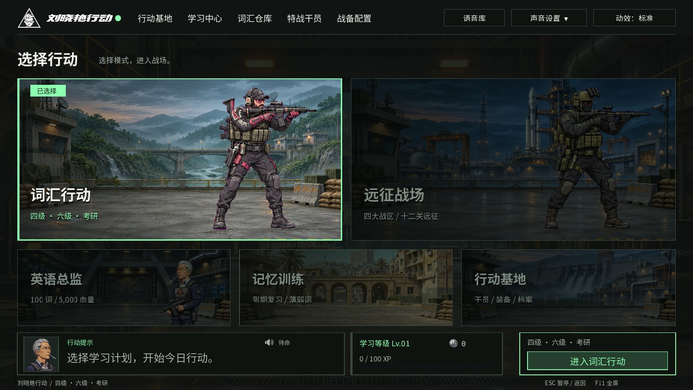
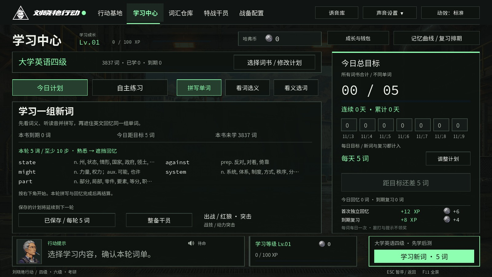
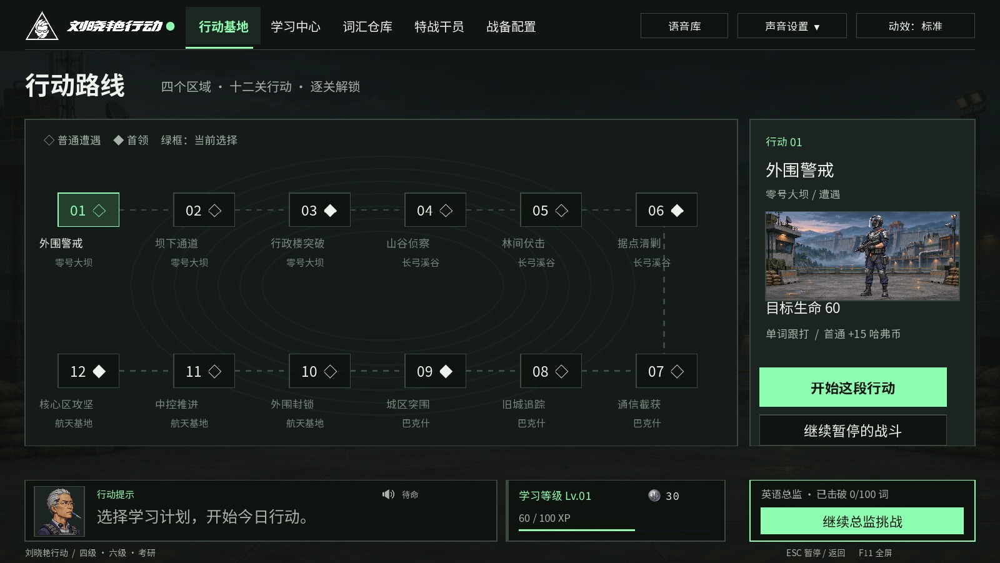
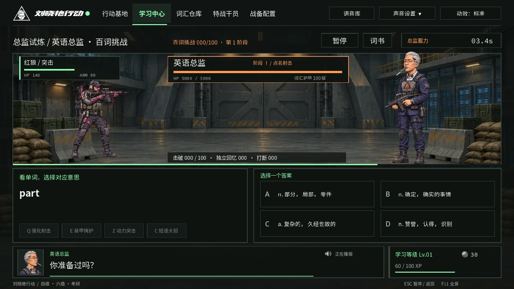

# 刘晓艳行动

**把背单词变成一场行动。** 选一本词书，答题推进关卡，招募干员，再去挑战英语总监。学习进度、错题和收藏会留在存档里，方便下一次接着练。

**[在线试玩](https://gityuanbao.github.io/liuxiaoyan-action/)** · [B 站视频教程](https://www.bilibili.com/video/BV1bNsb6fENp/) · [版本记录](https://github.com/gityuanbao/liuxiaoyan-action/releases) · [反馈问题](https://github.com/gityuanbao/liuxiaoyan-action/issues)

## 下载最新版 v56

| 版本 | 下载或打开 | 怎么开始 |
| --- | --- | --- |
| Windows 10 / 11（64 位） | [下载 Windows EXE](https://github.com/gityuanbao/liuxiaoyan-action/releases/download/v56/LiuxiaoyanAction-v56-Windows.exe) | 双击运行。首次启动会解压并校验游戏文件。 |
| macOS 11 及以上（Apple 芯片 / Intel） | [下载 Mac 通用版 ZIP](https://github.com/gityuanbao/liuxiaoyan-action/releases/download/v56/LiuxiaoyanAction-v56-macOS-Universal.zip) | 解压后，把「刘晓艳行动.app」拖到「应用程序」并打开。 |
| 电脑和手机浏览器 | [直接试玩](https://gityuanbao.github.io/liuxiaoyan-action/) | 加载完点击「开始行动」。手机请横屏。 |
| 完整项目源码 | [下载 v56 源码 ZIP](https://github.com/gityuanbao/liuxiaoyan-action/archive/refs/tags/v56.zip) | 包含 Godot 工程、素材、词库及已构建的网页。 |

桌面包自带运行环境和离线词音，可以离线玩。如果 Mac 首次启动提示开发者无法验证，当前构建尚未经过 Apple 公证，请参考 [Apple 的首次打开说明](https://support.apple.com/zh-cn/102445)。需要核对下载文件时，在 [v56 发布页](https://github.com/gityuanbao/liuxiaoyan-action/releases/tag/v56) 下载校验文件。


[查看手机横屏实机](docs/screenshots/v56-mobile-wildfire.png)

## v56 更新

- **新增中考和高考词书。** 五本词书可以单独选用，支持设置每日目标和每轮词数。
- **收藏后单独复习。** 答题时可收藏单词，在「收藏单词」里跨词书复习。选完答案会显示反馈，再自动进入下一题。
- **更新干员招募。** 每抽 30 哈弗币，返还 3、6 或 9 币，另有 5% 概率返还 300 币。累计 40 抽保底解锁一名尚未获得的干员。
- **野火加入机库展示。** 选中后播放入场动作，也可以手动演示技能。
- **适配手机横屏。** 手机上提供「看词选意」和「看意选词」，桌面版还可以练拼写。

## 游戏玩法

1. **安排学习。** 选择词书和每日目标，每轮练 5、10 或 15 个单词。
2. **答题闯关。** 用拼写或四选一训练推进词汇行动，拿到经验和哈弗币。远征包含四个区域、十二关行动，英语总监挑战需要完成 100 词。
3. **回顾错题和收藏。** 在词汇仓库复习收藏。游戏根据学习记录安排间隔复习，也可以按每日目标打卡。

| 词书 | 词条数 |
| --- | ---: |
| 中考英语 | 1,597 |
| 高考英语 | 3,674 |
| 大学英语四级 | 3,836 |
| 大学英语六级 | 5,390 |
| 考研英语 | 4,793 |

不同词书之间有部分词条重合。

<details>
<summary>查看选词书、答题、远征和结算实机画面（v51）</summary>










</details>

## 存档

- **桌面版**使用本机存档，升级后会读取同一系统用户下的原桌面版进度。
- **网页版**按浏览器和站点保存进度。可以在顶栏点击「导出进度」下载 JSON 备份。更换浏览器、设备或试玩站点时，学习进度需要重新开始。

## 源码与开发

<details>
<summary>在 Godot 中运行或本地预览网页版</summary>

**Godot 工程**

1. 下载并解压源码，或克隆仓库。
2. 安装 Godot 4.5.1 标准版和 Node.js 22.18 或以上版本。
3. 在 Godot 的项目管理器中导入 `godot/project.godot`，等待导入完成，再按 **F5**。如果使用了自定义的 Node.js 安装路径，可以通过 `WORD_GAME_NODE` 指定。

**本地预览网页版**

在项目根目录打开终端，用 Python 3 启动本地 HTTP 服务。

```bash
python -m http.server 8000 --bind 127.0.0.1 --directory docs
```

打开 [本机试玩页](http://127.0.0.1:8000/)。Windows 上也可用 `py`，macOS 上也可用 `python3`。

**构建网页**

修改学习逻辑或浏览器适配后，到 `web/` 运行 `npm ci` 和 `npm run build`。需要重新导出场景或素材时，使用 Godot 4.5.1 的导出模板和 `godot/export_presets.cfg` 中的 Web 预设。部署资源位于 `docs/`。

```text
docs/         GitHub Pages、语音资源、游戏截图、第三方许可
godot/        游戏场景、界面脚本、美术、词书和本地玩法服务
web/          浏览器适配与构建脚本
COPYRIGHT.md  项目制作与版权说明
```

</details>

## 制作与许可

Git源宝团队制作。[版权声明](COPYRIGHT.md) · [素材来源](godot/ASSET_SOURCES.md) · [词典、FSRS 与开源依赖](godot/OPEN_SOURCE.md) · [第三方许可](docs/licenses/)
