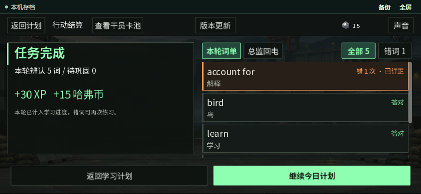

# 刘晓艳行动

用答题推进关卡，把错过的词留到下一轮复习。内置中考、高考、四级、六级和考研五本词书，也可以带自己的词表来练。

**[免安装试玩](https://gityuanbao.github.io/liuxiaoyan-action/)** · **[B 站 Toy](https://www.bilibili.com/toy/liuxiaoyan-action/index.html)** · [视频教程](https://www.bilibili.com/video/BV1bNsb6fENp/) · [版本记录](https://github.com/gityuanbao/liuxiaoyan-action/releases)

## 下载 v58

| 设备 | 下载 | 怎么开始 |
| --- | --- | --- |
| **Android** | [安卓原生版 APK](https://github.com/gityuanbao/liuxiaoyan-action/releases/download/v58/LiuxiaoyanAction-v58-Android-Native.apk) · 132.7 MB | Android 7.0 及以上，ARM64。下载后在手机上打开 APK。 |
| **Windows** | [Windows EXE](https://github.com/gityuanbao/liuxiaoyan-action/releases/download/v58/LiuxiaoyanAction-v58-Windows.exe) · 159.9 MB | Windows 10 / 11，64 位。双击运行，首次启动会解压和校验游戏文件。 |
| **macOS** | [Mac 通用版 ZIP](https://github.com/gityuanbao/liuxiaoyan-action/releases/download/v58/LiuxiaoyanAction-v58-macOS-Universal.zip) · 222.3 MB | macOS 11 及以上，支持 Apple 芯片和 Intel。解压后将应用拖进「应用程序」。 |

Android APK 使用测试签名。Mac 构建尚未经过 Apple 公证。Windows 和 macOS 版自带离线词音。[Apple 首次打开说明](https://support.apple.com/zh-cn/102445)

创作者更新包、源码和文件校验值见 [v58 发布页](https://github.com/gityuanbao/liuxiaoyan-action/releases/tag/v58)。

## 从第一轮开始

1. 网页加载后点「进入行动」。在「学习中心」选词书、每日目标和每轮词数，每轮可选 5、10 或 15 词。
2. 手机横屏可选「看词选意」或「看意选词」。桌面还能练「拼写单词」。
3. 答完回顾本轮所有词和释义。错过的词会重点标记，之后答对也保留标记。想单独练的词可以收藏。



### 选择词书和难度

| 词书 | 词条数 |
| --- | ---: |
| 中考英语 | 1,597 |
| 高考英语 | 3,674 |
| 大学英语四级 | 3,836 |
| 大学英语六级 | 5,390 |
| 考研英语 | 4,793 |

词书之间有部分词条重合。「只练基础」按内置常用词频前 2,000 名出题，也可选「全部词汇」或「跳过基础」。筛选适用于今日计划、自主练习和总监挑战，百词挑战需要至少 100 个不同词条。

### 导入自己的词书

在「学习中心」的词书设置里打开「自定义词书」，粘贴词条或点「导入文件」。支持 UTF-8 的 TXT、CSV、TSV 和 JSON，单个文件最多 2 MB，每本最多 12,000 条。保存前可核对有效项、重复项和释义。

<details>
<summary>查看词表格式示例</summary>

CSV 可用 `word,meaning` 或 `单词,释义` 作表头。短语可以和单词放在同一本里。

```csv
word,meaning
apple,苹果
learn,"学习，得知"
account for,解释
```

JSON 可用词条数组，例如 `[{"word":"apple","meaning":"苹果"}]`。纯英文词表会尝试用内置词库补释义，无法匹配的词可根据提示补上。大词表只预览前几项，保存时会导入整本有效词表。

</details>

## 关卡、干员和排行榜

- **词汇行动与远征**。答题获得学习 XP 和哈弗币。远征有四个区域、十二关，英语总监挑战需完成 100 词。
- **干员招募**。每抽 30 哈弗币。常规返还 3、6 或 9 币，有 5% 概率返还 300 币。40 抽保底解锁一名尚未获得的干员。选中干员可看入场动作，也可手动演示技能。
- **B 站 Toy 排行榜**。电脑在「学习中心」右上方，手机在横屏「今日学习计划」的「收藏单词」旁。点「同步成绩」可参与累计学习 XP 排名，游戏内展示前十名。每天可膜拜一名其他上榜玩家，领取 10 哈弗币，按北京时间刷新。

[在 B 站 Toy 打开游戏](https://www.bilibili.com/toy/liuxiaoyan-action/index.html) · [查看手机横屏实机](docs/screenshots/v56-mobile-wildfire.png)

## 学习存档

桌面版保存到本机，更新后会读取同一系统用户下的原桌面版进度。网页试玩按站点和浏览器保存，可点顶部「备份」导出 JSON。登录 B 站后可在 Toy 内同步学习进度。自定义词表保存在导入设备，换设备时可重新导入原文件。

## 源码与开发

<details>
<summary>运行 Godot 工程或本地预览网页</summary>

1. 下载源码或克隆仓库。安装 Godot 4.5.1 标准版和 Node.js 22.18 或以上版本。
2. 在 Godot 中导入 `godot/project.godot`，完成资源导入后按 **F5**。如需指定 Node.js 路径，可设置 `WORD_GAME_NODE`。
3. 本地预览网页时，在仓库根目录启动 HTTP 服务并打开 [本机试玩页](http://127.0.0.1:8000/)。

```bash
python -m http.server 8000 --bind 127.0.0.1 --directory docs
```

修改浏览器适配后，在 `web/` 运行 `npm ci` 和 `npm run build`。重新导出场景或素材时，使用 Godot 4.5.1 导出模板与 `godot/export_presets.cfg` 中的 Web 预设。GitHub Pages 发布目录为 `docs/`。

</details>

---

Git源宝团队制作。[反馈问题](https://github.com/gityuanbao/liuxiaoyan-action/issues) · [版权声明](COPYRIGHT.md) · [素材来源](godot/ASSET_SOURCES.md) · [开源依赖](godot/OPEN_SOURCE.md) · [第三方许可](docs/licenses/)
